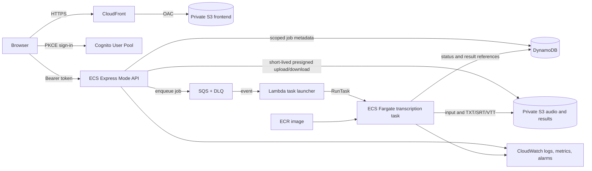

# EchoScript AWS deployment proposal

**Status: revised architecture proposal; owner review required before application infrastructure is changed or provisioned.** The bootstrap state bucket, lock table, and two ECR repositories have already been created in the new account `598391748654`, region `us-west-2`, under the earlier limited approval. No application services, data buckets, or user-facing resources have been created. The old account, credentials, state, buckets, identities, and infrastructure are out of scope.

## Architecture

The existing three-account EC2/k3s plan does not fit the confirmed single new account and is incomplete in source. This proposal uses one account and managed AWS services. It is a material architecture change and needs owner approval before implementation or provisioning.

- CloudFront serves the SPA from a private S3 origin using Origin Access Control. Its AWS-provided `cloudfront.net` host supports HTTPS, so a custom domain is optional for the first release.
- Cognito provides sign-in with the existing browser PKCE flow. The API verifies access tokens and authorizes every job using the token subject.
- ECS Express Mode hosts the FastAPI API on Fargate behind an HTTPS Application Load Balancer. The API uses a scoped task role for DynamoDB, S3, and SQS. This replaces App Runner because AWS closed App Runner to new customers and recommends ECS Express Mode for new deployments ([AWS availability notice](https://docs.aws.amazon.com/apprunner/latest/dg/apprunner-availability-change.html)).
- S3 holds source audio and generated outputs, with public access blocked and encryption enabled. The API issues short-lived presigned upload/download URLs after checking ownership.
- DynamoDB stores the job lifecycle, keyed by owner subject and job ID. SQS plus a dead-letter queue tracks processing requests. A small Lambda launcher starts one ECS Fargate task per job; the worker downloads the audio, runs FFmpeg and faster-whisper, writes TXT/SRT/VTT, and records completion or failure.
- ECR stores immutable API and worker images. CloudWatch captures logs and service/job metrics. AWS Budgets sends cost threshold notifications.
- The worker has no inbound access. GPU is not proposed; the initial worker uses a multilingual tiny CPU model and one job per task. We must validate transcription time and output quality with a known-speech file before selecting larger resources.

ECS Express Mode supplies the API's HTTPS endpoint, load balancer, scaling configuration, and networking. CloudFront's default hostname also supports HTTPS. These avoid a custom DNS dependency for the initial deployment. AWS charges no separate ECS Express Mode fee; the underlying Fargate, Application Load Balancer, public IPv4, logging, and data-transfer resources are billed ([ECS Express Mode overview](https://docs.aws.amazon.com/AmazonECS/latest/developerguide/express-service-overview.html)). S3 access should use OAC, which AWS recommends for private origins ([OAC documentation](https://docs.aws.amazon.com/AmazonCloudFront/latest/DeveloperGuide/private-content-restricting-access-to-s3.html)).

## Planning cost

This is a planning estimate, not a bill quote. It assumes `us-west-2`, one always-running 1 vCPU/2 GB Linux x86 API task (730 hours/month), one internet-facing ALB across two Availability Zones, one public IPv4 address on the running API task, 100 worker task-hours/month at 2 vCPU/6 GB, 100 GB stored, low request volume, and modest logs/egress. It excludes tax, custom-domain fees, support plans, and unusually high data transfer. The API task is always on to provide a responsive web API; it does not scale to zero.

| Cost area | Planning monthly range | Main assumption |
|---|---:|---|
| ECS Express API Fargate task | ~$36 | 1 vCPU/2 GB x86 for 730 hours at the current us-west-2 list rates ($0.04048/vCPU-hour and $0.004445/GB-hour). |
| Application Load Balancer | ~$16–$25 | 730 hours at about $0.0225/hour plus a low-traffic LCU allowance; actual LCU use varies. AWS's published example uses the $0.0225 hourly rate and $0.008/LCU-hour. |
| Public IPv4 addresses | ~$11 | Planning for two ALB addresses plus one public address on the API task, each at $0.005/hour. Actual assigned addresses can vary. |
| Fargate transcription worker | ~$11–$15 | About 100 billed hours/month at 2 vCPU/6 GB, based on Fargate's vCPU and memory billing. |
| S3, DynamoDB, SQS, Lambda, ECR, CloudFront, CloudWatch | $10–$25 | 100 GB total object storage, low request volume, modest logs and egress. |
| **Estimated total** | **$85–$110/month** | Low-volume first release, no GPU or NAT Gateway; includes always-on API compute and public load balancer. |

Every additional 100 Fargate worker-hours is approximately another $11–$15 at the planning rate; higher transcription volume increases this line. The API runs continuously and its baseline compute is about $36/month before load balancing and IP charges. The API and worker use pay-for-duration billing, while storage, logs, LCU usage, and data egress vary with actual usage. Fargate pricing depends on task CPU, memory, storage, and runtime ([Fargate pricing](https://aws.amazon.com/fargate/pricing/)); ALB billing includes hourly and LCU use ([ALB pricing](https://aws.amazon.com/elasticloadbalancing/pricing/)); public IPv4 is $0.005/address-hour ([VPC pricing](https://aws.amazon.com/vpc/pricing/)). These are list-rate planning calculations, not a final AWS Pricing Calculator quote. The old `$35–$66/month` estimate assumed App Runner and is superseded. Recreate the estimate in the [AWS Pricing Calculator](https://calculator.aws/) with the final task sizing and traffic assumptions before authorizing the application deployment.

## Required approvals and dependencies

The account identity and region are confirmed, and AWS IAM Identity Center access succeeded. The initial bootstrap resources were provisioned with the owner's limited approval. This revised ECS Express Mode design and `$85–$110/month` estimate are not yet approved. Do not change or provision application infrastructure until the owner approves the revised design and cost range. Do not send passwords or access keys in chat. Actual spend depends on task runtime, storage, logs, LCU use, and data transfer; the planning range is not a bill cap.

The application adapters and task-launch workflow are now implemented in source but remain locally unverified as an integrated cloud system. Cognito user-pool/client IDs and callback URLs, bucket names, ECR repository URLs, role ARNs, and Terraform state must be created for the new account. S3 names are generated from the new account ID; no old bucket or state name is reused.

## Deployment sequence after separate provisioning approval

1. After approval, revise the Terraform provider and replace the App Runner API resource with ECS Express Mode, including task and infrastructure roles and required network configuration. Review provider-version compatibility before implementation.
2. Initialize Terraform from `infrastructure/terraform/single-account` against the already bootstrapped new-account state backend. Keep state in the new account with encryption and locking.
3. The two immutable ECR repositories already exist in the new account. Confirm their names and account ownership from the active profile; do not recreate or replace them.
4. Run `scripts/publish-images.sh <git-commit-sha>` to build and push immutable API and worker images. The script checks the active account and region against Terraform state.
5. Review a fresh Terraform plan, including replacement and deletion actions, then obtain explicit approval before full apply. Set `image_tag` to the published commit SHA.
6. Run `scripts/deploy-frontend.sh`; it verifies account and region, builds the SPA with the newly created API/Cognito outputs, syncs the private web bucket, and invalidates CloudFront.
7. Complete the authenticated real-audio end-to-end acceptance checks in the handover. Do not report cloud deployment complete until these pass.

## Rollback and recovery

Publish immutable image tags and retain prior ECS task definitions. Roll back the ECS Express API to the prior image and task definition, restore the previous frontend bundle through the CloudFront distribution, and leave S3/DynamoDB data intact. Failed jobs remain in the SQS dead-letter queue for controlled inspection/retry. Terraform state is encrypted and locked in the new account; destroying buckets or data is outside routine rollback and requires explicit approval.
